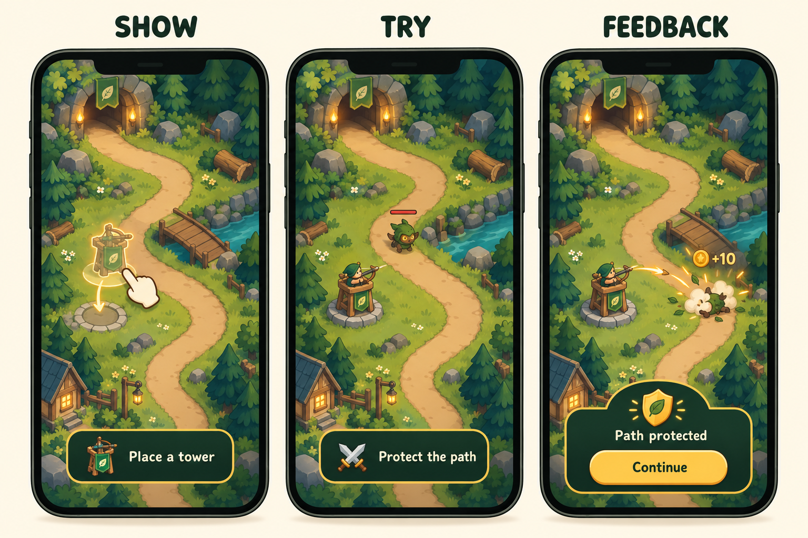

# Show → try → feedback

Use a visual when it explains an action or relationship better than prose. The
following is a synthetic design proposal, not measured evidence.



Original generated teaching concept. [Prompt and provenance](../assets/visual-teaching-prompt.md).
The example depicts intended feedback; it does not prove a durable grant or
successful teaching. Its three stages are also described below.

```text
SHOW                      TRY                       FEEDBACK
Legal pad + ghost tower → Player places a tower → Tower stops an enemy
“Place a tower”            Allow cancel/reposition   “Path protected”
                                                   Confirm earned progress
                ↓                               ↓
          accessible static cue         next attempt without the cue
```

The next attempt without help checks learning. A tap on a highlighted target
alone proves only that the player followed the highlight. For strategic games,
later test a different valid location or enemy type to check transfer.

## Choose the right visual artifact

| Question | Useful artifact | Check before use |
|---|---|---|
| Which screen comes next? | Editable flow diagram | Back, skip, error and returning-player paths included |
| Where should I tap? | Annotated screenshot or live highlight | Target is valid/reachable; no cue placed over a threat |
| How does the action work? | Short storyboard or in-engine demonstration | Same camera/controls as play; player can practise |
| How does an upgrade change combat? | Before/after range or damage preview | Uses real values; not exaggerated marketing art |
| What style is appropriate? | Generated or commissioned concept mockup | Labelled proposal; readable at device size; rights/provenance recorded |

Use actual screenshots when auditing existing behaviour. Generated UI is a
concept and must not be passed off as a tested screen or a working build.
Prefer live labels and engine primitives in shipped tutorials. Avoid embedded
text in textures; it is harder to translate, scale and expose to assistive tools.
Put captions/text equivalents with guide images so meaning survives a failed
image load. Avoid flashing or motion-only teaching; provide a static alternative.

## Reusable image-generation brief

“Create a three-panel storyboard of [original mechanic] for [audience/device].
Show the action, a player attempt, and truthful feedback. Use consistent camera,
geometry and icon meanings. Keep text to these exact short strings: [strings].
Leave safe margins. No misleading reward values or hidden decline route. This
is an illustrative concept, not measured evidence or production UI.”

Inspect generated results for malformed controls, illegible strings, inconsistent
geometry and missing alternatives. Correct or reject them; do not use a visually
attractive but mechanically false explanation. Preserve the prompt and source.
Use a normal file size suitable for documentation. Production assets need a
separate import/compression, memory, licensing and device-readability check.

Measure task understanding before adding heavier media. A small reusable ghost
sprite can teach placement without shipping a full-screen video. Reuse visual
components and document the incremental download/memory budget. A guide can be
visual without making every game install larger.
